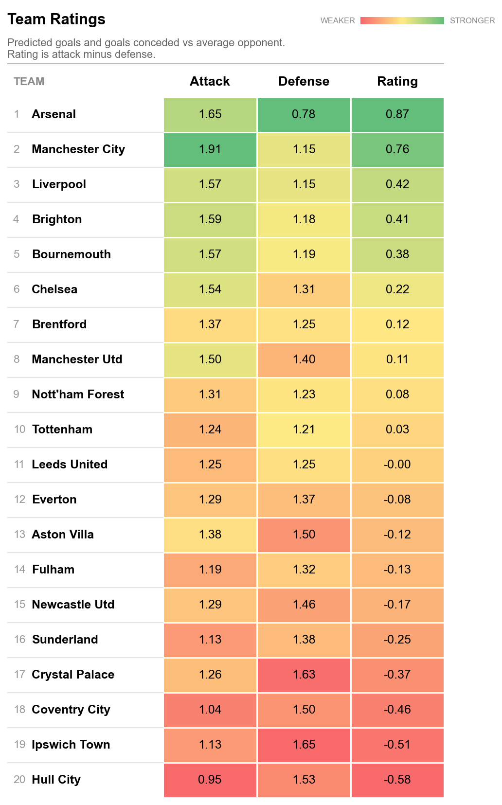
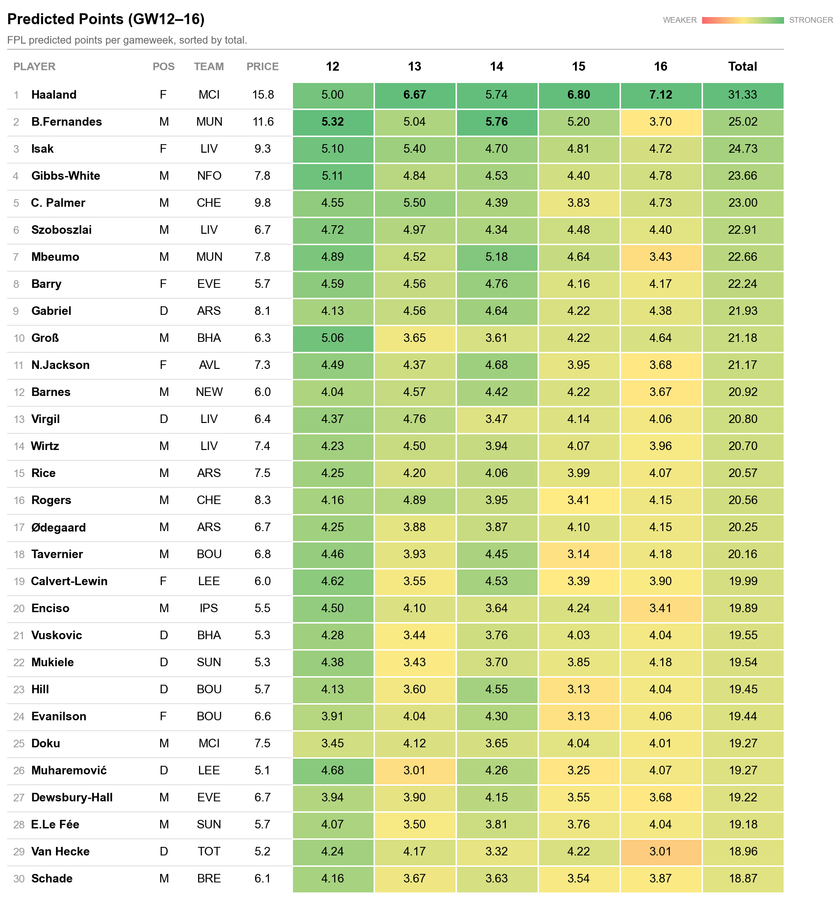
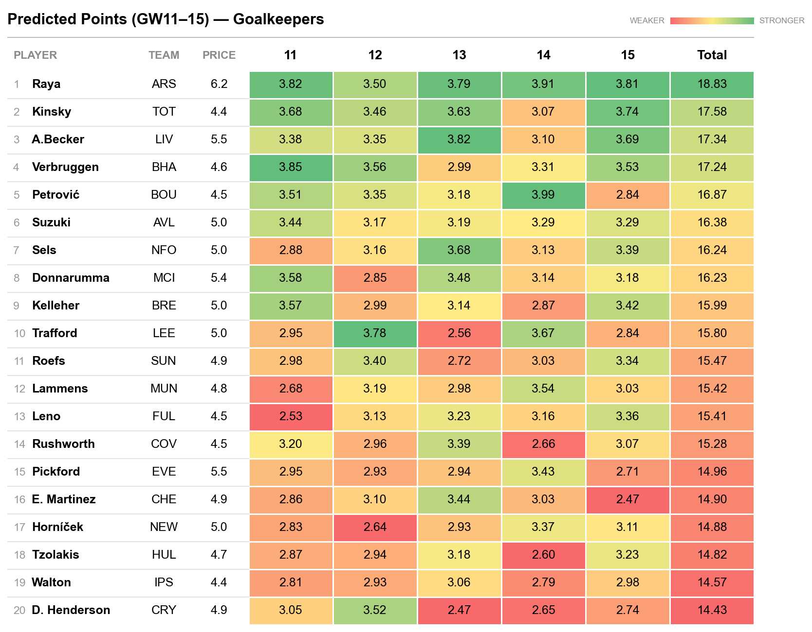

# FPL Model

Weekly outputs are now archived automatically after both pipeline halves in
`data/snapshots/<season>/GWxx/<UTC timestamp>_GWxx_<timing>_part<part>/`. Each run
retains a separate snapshot of the original CSVs, gameweek-specific views and a
SHA256 manifest. Ratings snapshots are saved after the post-gameweek run; full
snapshots, including predicted points, are saved after the pre-deadline run.
Timing says whether the snapshot was saved before that gameweek's FPL deadline:
`pre_deadline`, `after_deadline` or `deadline_unknown`. Only a `pre_deadline`
snapshot counts as a genuine forecast of that gameweek.

To save another full snapshot before the deadline, run:

```
python save_gameweek_outputs.py
```

Use `--gameweek 8` to choose the gameweek (`run_post_gameweek.py` and
`run_pre_deadline.py` accept it too), `--part 1` for ratings only, or
`--include-images` to include the rendered charts. Full snapshots reject stale
forecast origins or points assembled before newer inputs: run
`python run_pre_deadline.py` first. `--verify <snapshot directory>` checks a saved
snapshot. Existing snapshots are never overwritten; archives are kept locally
and gitignored.

A Fantasy Premier League points-prediction pipeline. Every week it:

1. rates each Premier League team's attack and defence from match results,
2. rates each player's non-penalty goals, assists and defensive contribution,
3. forecasts minutes, penalties and clean sheets,
4. simulates bonus points, and
5. assembles everything into per-player, per-gameweek predicted points for
   the next ten fixtures (the window is set once, in `fpl_model/forecast_horizon.py`).








## The four models

| Model | What it predicts | Documentation |
|---|---|---|
| Team ratings | Non-penalty goals for/against each team per fixture | [fpl_model/team_ratings/README.md](fpl_model/team_ratings/README.md) |
| Goal/assist ratings | NPG/90 and Assists/90 for every player | [fpl_model/player_ratings/README.md](fpl_model/player_ratings/README.md) |
| Defcon | P(defensive contribution clears a threshold) per fixture | [fpl_model/defcon/README.md](fpl_model/defcon/README.md) |
| Predicted points | All facets combined into weekly FPL points | [fpl_model/assemble/README.md](fpl_model/assemble/README.md) |

Supporting stages (each documented in its module docstring):

- `fpl_model/fetch/` — pulls squads, fixtures, results and live player stats
  from the official FPL API.
- `fpl_model/minutes_penalties_cs/` — turns the FPL Review expected-minutes
  forecast into appearance and 60+-minute probabilities, and builds penalty
  predictions from fixture goal forecasts plus the penalty-share table.
- `fpl_model/bonus/` — a residual BPS baseline and a Monte Carlo bonus-points
  simulation with official tie-breaking rules.
- `fpl_model/export_weekly_heatmaps.py` — renders the weekly heatmaps and
  next-gameweek charts into `images/team_ratings/`, `images/player_ratings/`,
  `images/predicted_points/`, `images/next_gameweek/` and `images/fdr/`.

## Weekly flow

The pipeline runs in two halves, at two different points in the week.

**Part 1 — as soon as the gameweek ends** (needs the network for its fetches):

```
python run_post_gameweek.py              # standard post-gameweek update
python run_post_gameweek.py --preseason  # at season start (adds preseason ratings blend)
```

Runs, in order: fetch squads/prices → fetch gameweek player stats → fetch
fixtures and results → FotMob match pages (per-match positions, shots, red cards;
Understat until it went down in 2026) → position crosswalk →
penalty log from the shot data (fills `penalty_log.csv` and reconciles
penalty goals in the match data) → team ratings update → preseason blend
(`--preseason` only) → player goal/assist ratings → defcon predictions →
player ratings export → part-1 heatmaps → fixture tickers (overall, attack, defense; `images/fdr/`) →
predicted final table → next-gameweek predicted scores. Everything here depends only on what has already
happened on the pitch. This is the slow half: budget 25–35 minutes, dominated
by the defcon model.

**Part 2 — later in the week**, once expected minutes and the penalty share
have settled:

```
python run_pre_deadline.py
```

Runs, in order: minutes probabilities → fixture goal predictions → penalty
predictions → residual BPS baseline → simulation features → bonus simulation
→ predicted points assembly → part-2 heatmaps. A couple of minutes in total.

Manual inputs it expects to be current: `data/current/minutes.csv` and
`data/current/review_pk_share.xlsx` (both from FPL Review) and
`data/current/fixtures.csv`.

Stage order matters in both halves — for example `fetch_fixtures_results.py`
derives each new result's team xG from the player stats, so it warns and skips
any fixture whose stats have not been fetched yet; and penalty predictions read
the fixture goal file produced by the immediately preceding stage, so running
them against a stale file would cover the wrong rounds. Either orchestrator
halts at the first failing stage.

## Repository layout

```
fpl_model/
├── data/
│   ├── raw/                   # original source data (fbref 2017-24, FPL-API 2025+ player stats)
│   ├── current/               # the "live" files every script reads/writes
│   └── archive/               # superseded files kept for traceability (not in the repo)
├── scripts/
│   ├── team_ratings/          # exponential smoothing, preseason blend, fixture goals
│   ├── player_ratings/        # NPG/90 and assist ratings, transfers fill
│   ├── defcon/                # defensive contribution threshold model
│   ├── minutes_penalties_cs/  # minutes probabilities, penalty predictions
│   ├── bonus/                 # residual BPS, Monte Carlo bonus simulation
│   ├── assemble/              # simulation features, predicted points
│   └── fetch/                 # FPL API fetchers
├── images/                    # weekly heatmap exports (PNG), one folder per family
├── pipeline_stages.py         # shared stage runner for both orchestrators
├── run_post_gameweek.py       # part 1: fetches + the three model stages
├── run_pre_deadline.py        # part 2: minutes -> predicted points
├── requirements.txt
└── README.md
```

## Setup

Python 3.13 with:

```
pip install -r requirements.txt
```

A full weekly run takes roughly 25–35 minutes, nearly all of it part 1's
defcon model (about 20 minutes to train its models on fresh data, around 6
minutes when its trained-model cache is warm). Every other stage completes in
seconds to a couple of minutes, so part 2 is quick.

## Data sources

- **FPL API** (`fantasy.premierleague.com`) — squads, fixtures, results and
  live gameweek stats. Public, no key required.
- **fbref** — historical player match stats 2017–2024, saved once to
  `data/raw/all_player_stats.csv`.
- **FPL Review** — the ten-gameweek expected-minutes forecast (saved as
  `data/current/minutes.csv`) and the penalty-share table (pasted into
  `data/current/review_pk_share.xlsx`, cleaned by
  `clean_penalty_share_paste.py`).

Manually maintained inputs: `data/current/fixtures.csv` (upcoming fixtures)
and the two FPL Review files above have no fetcher and are updated by hand.

## Key consolidated data files

| File | Contents |
|---|---|
| `data/current/match_results.csv` | Match results 2017–present (goals, NPG, penalties, NPxG) |
| `data/current/fixtures.csv` | Upcoming fixtures for the next rounds (manual) |
| `data/current/player_match_stats.csv` | Harmonized fbref + FPL-API player match stats |
| `data/current/team_ratings_current.csv` | Latest attack/defence ratings per team |
| `data/current/team_ratings_history.csv` | Per-match team ratings history |
| `data/current/money_priors_by_season.csv` | Per-season money priors for the preseason blend |
| `data/current/player_goal_assist_ratings.csv` | NPG/90 and Assists/90 per player |
| `data/current/predictions_defensive.csv` | Fixture-level defcon probabilities |
| `data/current/defcon_average_probabilities.csv` | Fixture-neutral 90-minute defcon probability |
| `data/current/minutes_probabilities.csv` | Per-GW appearance and 60+-minute probabilities |
| `data/current/penalty_predictions.csv` | Per-GW expected penalty goals/points |
| `data/current/bonus_predictions.csv` | Per-GW expected bonus points |
| `data/current/predicted_points.csv` | Final per-player, per-gameweek predicted points |
| `data/current/player_ratings.csv` | Weekly ratings card: NPG, Assists, Defcon per player; players who have left the league are left out |
| `data/current/gameweek_deadlines.csv` | Each gameweek's FPL deadline, written by `fetch_bootstrap.py`; snapshots use it for their timing tag |
| `data/current/set_piece_orders.csv` | FPL's corner, free-kick and penalty orders, one row per player and gameweek, appended by `fetch_bootstrap.py` from GW10 (§196); data only, not yet used by a model |
| `data/current/vaastav_name_overrides.csv` | Reviewed identities for `vaastav_player_match_history.csv`, applied by `build_vaastav_history.py` |
