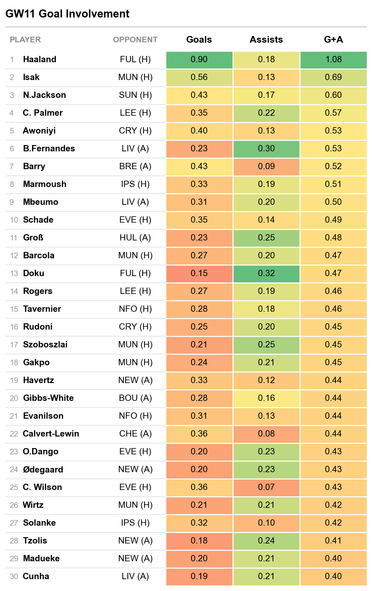
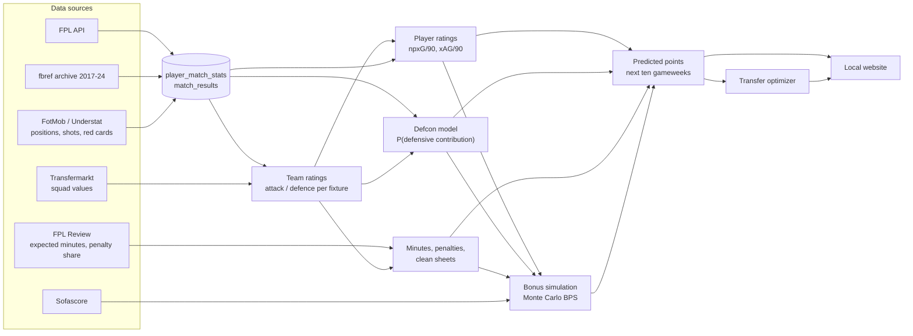

# FPL Model

A Fantasy Premier League points-prediction pipeline. Every week it rates each Premier League team's attack and
defence, rates every player's non-penalty goals, assists and defensive contributions, forecasts minutes, penalties,
clean sheets and bonus points, and assembles them into expected FPL points per player for each of the next ten
gameweeks. A transfer optimizer and a small local website sit on top. The aim is a forecast that is honest about what
it knows: every model change is pre-registered and tested out of time against the model it would replace, and most
candidates failed and were not adopted.




## How it fits together



| Model | What it predicts | Documentation |
|---|---|---|
| Team ratings | Non-penalty goals for and against each team in each fixture (exponential smoothing with a preseason prior from squad values) | [fpl_model/team_ratings/README.md](fpl_model/team_ratings/README.md) |
| Goal/assist ratings | Non-penalty xG and xA per 90 for every player, with priors for players arriving from other leagues | [fpl_model/player_ratings/README.md](fpl_model/player_ratings/README.md) |
| Defcon | The probability that a player's defensive actions clear FPL's threshold in a fixture (three calibrated classifiers) | [fpl_model/defcon/README.md](fpl_model/defcon/README.md) |
| Predicted points | Minutes, goals, assists, clean sheets, saves, cards, defcon and simulated bonus combined into FPL points | [fpl_model/assemble/README.md](fpl_model/assemble/README.md) |

## How the models are validated

A change to a production model has to earn its place. Before a test runs, the expected direction and size of the
effect are written down. The candidate is then scored out of time (trained only on matches before the ones it
predicts) against the incumbent, on the target that matters (for example the squared error of match npxG, or log loss
on FPL's real defensive-contribution hits), with bootstrap intervals clustered by player. A candidate that misses its
pre-registered bar is reported as a failure and not shipped. The experiments, including the many that failed, live in
[`research/`](research/README.md).

Refactoring is checked differently: `tools/regression_check.py` runs every offline stage of the pipeline in a sandbox
against frozen inputs and proves the outputs are unchanged, file by file.

## Quickstart

Python 3.11+ (developed on 3.13, Windows).

```
pip install -e .[dev]
python -m pytest          # tests that need the local data skip without it
ruff check .
```

The weekly run has three parts. They need the local `data/` folder (see below).

```
python run_post_gameweek.py   # part 1, after a gameweek: fetches, team and player ratings, defcon (~25-35 min)
python run_pre_deadline.py    # part 2, before the deadline: minutes, penalties, bonus, predicted points (~2 min)
python run_site_export.py     # part 3: export the website data and serve it at http://127.0.0.1:8766/
```

Any single stage runs on its own as a module, e.g. `python -m fpl_model.player_ratings.build_player_ratings`. Settings
that experiments switch through environment variables are declared in one place, `fpl_model/config.py`
(`python -m fpl_model.config` lists them). Both orchestrators stop at the first failing stage, and each part ends by
saving a timestamped snapshot of its outputs with a SHA-256 manifest, so a forecast made before a deadline can be
scored later against what happened.

## Repository layout

```
fpl_model/                 the package: every pipeline stage, as python -m fpl_model.<area>.<module>
  fetch/                   one fetcher per source (FPL API, FotMob, Understat, Sofascore, Transfermarkt, ...)
  team_ratings/            team attack/defence ratings, preseason priors, fixture goal predictions
  player_ratings/          goal/assist rating loop, new-player priors, the player ratings card
  defcon/                  defensive-contribution classifiers
  minutes_penalties_cs/    minutes probabilities and penalty predictions
  bonus/                   residual BPS baseline and the Monte Carlo bonus simulation
  assemble/                simulation features and predicted points
  optimizer/               transfer optimizer around a vendored open-fpl-solver
  site_export/             JSON export for the website
  config.py, paths.py      settings and data folders, each declared once
research/                  experiments behind every model decision (never imported by the package)
tools/                     regression check and applied one-off data migrations
tests/                     architecture, configuration and snapshot tests (more sit beside their modules)
site/                      the local website (static HTML/JS plus a small server)
images/                    the weekly charts shown above
run_post_gameweek.py, run_pre_deadline.py, run_site_export.py   the three weekly parts
```

## Data

No data is in this repository. The pipeline reads a local `data/` folder: frozen historical downloads in
`data/raw/`, the files each stage reads and writes in `data/current/`, snapshots in `data/snapshots/`. Some sources
can only be collected by hand or in a browser, some have terms that rule out redistribution, and the fbref archive
(Opta data for 2017-2024, no longer available there) could not be rebuilt. The weekly charts in `images/` are
published.

Sources: the official FPL API (squads, fixtures, results, live stats); fbref (player match stats 2017-2024, saved once
before Opta data left the site); FotMob and, until 2026, Understat (per-match positions, shots, red cards); Sofascore
(player match statistics for the bonus model); Transfermarkt (squad market values for preseason priors);
football-data.co.uk and ClubElo (research only); FPL Review (expected minutes and penalty shares, entered by hand);
vaastav's Fantasy-Premier-League archive (FPL history 2017-2024).

## Credits

- [open-fpl-solver](https://github.com/solioanalytics/open-fpl-solver) by Solio Analytics, vendored in
  `fpl_model/optimizer/open_fpl_solver/` under the Apache License 2.0 (its `LICENSE` is kept there; local patches are
  listed in `fpl_model/optimizer/PINNED.md`).
- [vaastav/Fantasy-Premier-League](https://github.com/vaastav/Fantasy-Premier-League) for historical FPL data.
- Understat, FotMob, Sofascore, Transfermarkt and fbref, whose data the models are built on; used for personal,
  non-commercial analysis, with requests throttled and raw responses cached.
